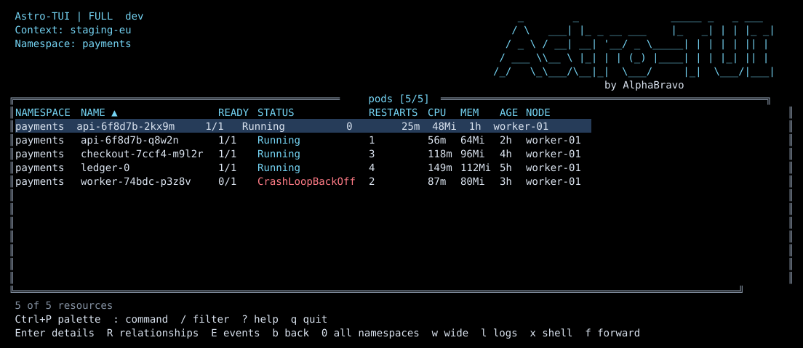

# astrotui

A Kubernetes terminal UI in the spirit of [k9s](https://k9scli.io), built in Go, intended as a daily-driver replacement.

> **Status:** initial implementation. The full design is in [`docs/specs/i-want-to-make-a-clone-of-k9s-but-call-it-astronomer-tui-and.md`](docs/specs/i-want-to-make-a-clone-of-k9s-but-call-it-astronomer-tui-and.md).

## Quickstart

Install the latest release:

```bash
curl -fsSL https://raw.githubusercontent.com/alphabravo-oss/astronomer-tui/main/install.sh | sh
```

Or build locally:

```bash
make
./bin/astrotui --context kind-kind
```

For non-interactive connectivity checks:

```bash
./bin/astrotui --headless --context kind-kind
```

Container usage:

```bash
docker run --rm -it -v "$HOME/.kube:/home/nonroot/.kube:ro" ghcr.io/alphabravo-oss/astronomer-tui:latest
```

## Screenshot



## Headline ideas

What we want to do better than k9s:

1. **Global command palette + fuzzy search** — VSCode-style palette is the primary navigation model, replacing memorized keybindings. Indexes resources, actions, contexts, namespaces, and plugins in one search.
2. **Optional, configurable AI assistant** — explain failures (Crash/OOM/ImagePull), summarize logs, lint manifests, and translate natural-language intent into actions. Multi-provider (Anthropic / OpenAI / Ollama). Off by default.
3. **Logs deluxe** — multi-pod merged stream, JSON/logfmt parsing, regex search, jump-to-source from a log line to its events or owning workload.
4. **Prod-context safety guard** — typed-confirmation modal for destructive verbs against contexts matching a configurable regex.
5. **Quality-of-life fixes** — session restore (last context+ns+filter), port-forward manager view, live `?` keybind overlay, drop-in compatibility with k9s `plugins.yaml`.

## Foundational decisions

| Area | Choice |
|---|---|
| Language | Go |
| TUI library | tview / tcell |
| Resource coverage | Full k9s built-in parity + dynamic CRDs |
| Auth (MVP) | Static kubeconfig + exec plugins (`aws`, `gcloud`, `kubelogin`) |
| Multi-cluster | Single active context + fast switcher |
| Editing | Shell out to `$EDITOR` |
| Config | `~/.config/astrotui/` (one-shot `config import-k9s` migrates skin/hotkeys/aliases) |
| Distribution | Signed GitHub Releases binaries + `ghcr.io/alphabravo-oss/astronomer-tui` container image |
| Telemetry | Zero |
| License | Apache-2.0 |

## Performance targets (NFRs)

- Cold start ≤ 300ms on a 1k-pod cluster
- List re-render ≤ 100ms after watch sync
- Idle CPU ≤ 2% on 1k-pod cluster
- RSS ≤ 150MB after 5 min of normal use
- Stripped binary ≤ 30MB per arch

## Out of scope (v1)

Helm release management, ArgoCD/Flux integration, cost/metrics overlay, web UI, OIDC token refresh, in-cluster service-account auth, Homebrew/Krew distribution. Some are roadmap; some are intentional non-goals.

## Roadmap

Eight phases, 43 user stories. See the [spec](docs/specs/i-want-to-make-a-clone-of-k9s-but-call-it-astronomer-tui-and.md#9-implementation-phases) for acceptance criteria.

1. Foundation (kubeconfig + auth, ResourceCache, generic table view)
2. Resource breadth (full k9s-parity renderers + CRDs)
3. Write actions + safety guard
4. Logs deluxe
5. Command palette + `?` overlay
6. Plugins, session restore, theming
7. AI module
8. Config, distribution, performance hardening

## Current implementation

- Go module and CLI at `github.com/alphabravo-oss/astrotui`.
- `make`, `make test`, `make lint`, and `make build` scaffolding.
- Kubeconfig loading through `clientcmd.NewNonInteractiveDeferredLoadingClientConfig`, including exec auth plugin registration.
- Dynamic informer-backed `ResourceCache` for arbitrary GVRs.
- tview/tcell Pods table entrypoint with help and palette overlays.
- Built-in and generic renderers for the k9s resource families listed in the spec.
- Fuzzy command palette index plus resource/action/context/namespace/plugin entry builders.
- Config loader, k9s import command, session persistence, prod-context safety guard.
- Log parsing/filtering helpers, AI provider interface/mock/Ollama HTTP path, plugin loader, theme defaults, and port-forward manager model.
- GoReleaser, install script, container image, and CI scaffolding.

## License

[Apache-2.0](LICENSE)
